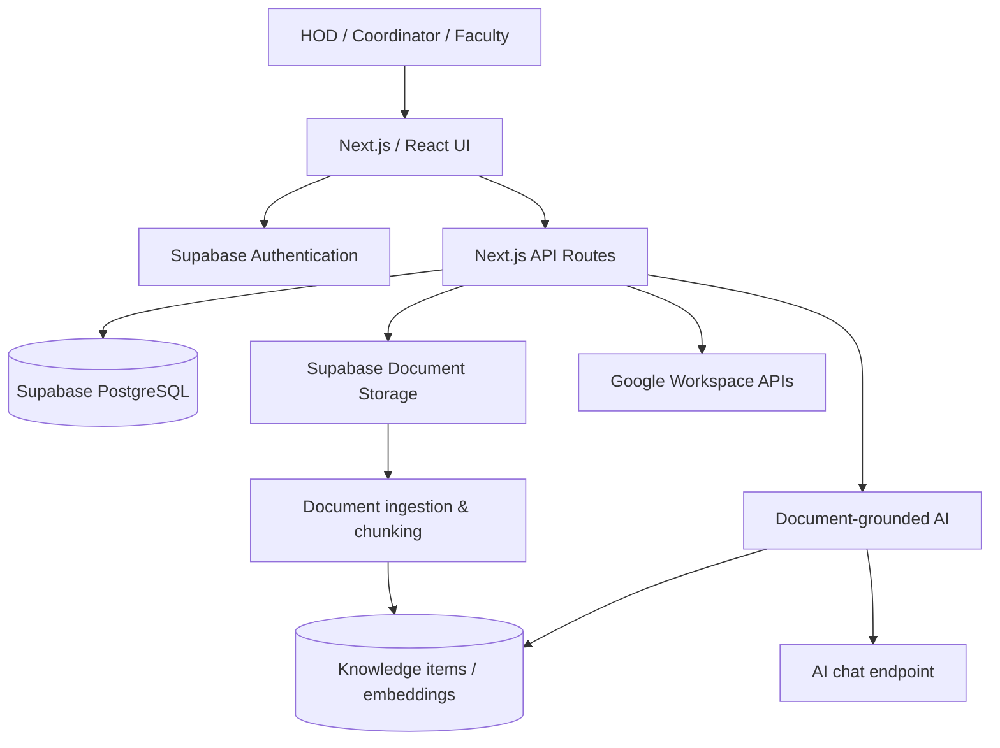

<div align="center">

# WorkHub AI

### One intelligent workspace for academic departments.

**Faculty coordination · Knowledge retrieval · Google Workspace · Department operations**

[Explore Features](#-features) · [Architecture](#-architecture) · [Get Started](#-getting-started) · [Contribute](CONTRIBUTING.md)

</div>

---

## ✨ Overview

**WorkHub AI** is a department-focused management and knowledge platform. It brings together faculty workflows, announcements, meetings, documents, tasks, and role-aware dashboards in one web application, with Google Workspace integration and a document-grounded AI assistant.

Built as a **Next.js + TypeScript** application with **Supabase** for authentication and data services, WorkHub is designed to make departmental information easier to organize, discover, and act on.

> **Repository guide:** The `develop` branch contains the application source. The previous `main` README described a broader multi-platform productivity concept; this README documents the academic-department application visible in `develop`.

## 🚀 Features

| Workspace | What it provides |
|:--|:--|
| 🧭 **Role-aware dashboards** | Interfaces for HOD, coordinator, and faculty roles |
| 👥 **Faculty & department** | Faculty records and department-focused views |
| 📣 **Announcements** | Announcement screens and associated data services |
| 📅 **Meetings & tasks** | Meeting and task pages with backend service integration |
| 📁 **Documents** | Document management and upload API |
| 🧠 **AI knowledge** | Retrieval-augmented Q&A using document chunks and source references |
| 🔗 **Google Workspace** | OAuth-based connections and integrations for Gmail, Drive, and Sheets |
| 🔔 **Supporting modules** | Notifications, reports, profile, settings, and help sections |

*Feature availability depends on configured Supabase/Google/AI credentials, database setup, role permissions, and the selected deployment. This overview describes the present codebase, not a guarantee that every integration works in every environment.*

## 🧰 Engineering stack

| Layer | Technologies |
|:--|:--|
| **Frontend** | Next.js 14, React 18, TypeScript, Tailwind CSS, Radix UI |
| **Backend** | Next.js API routes, server-side services |
| **Identity & data** | Supabase Auth, PostgreSQL, Supabase Storage |
| **AI retrieval** | Google Gemini embeddings, vector similarity search, retrieval-augmented generation |
| **AI responses** | Groq-compatible chat-completions endpoint (as configured in source) |
| **Integrations** | Google OAuth and Google Workspace APIs |

## 🏗 Architecture



The `src/app` directory contains routes and UI composition, `src/services` provides domain-specific data operations, `src/lib` contains authentication, document processing, embeddings and retrieval helpers, and `supabase/migrations` contains database migration material.

## ⚡ Getting started

### Prerequisites

- Node.js and npm compatible with the Next.js 14 project
- Supabase project with the schema, policies, and storage resources required by the application
- Relevant Google and AI credentials for optional integrations

### Run locally

```bash
git clone https://github.com/tejas764/workhub.git
cd workhub
git checkout develop
npm install
npm run dev
```

Open **http://localhost:3000**. To check a production build, run `npm run build`.

### Environment configuration

Create `.env.local` locally (never commit real credentials). The source references variables including:

```dotenv
NEXT_PUBLIC_SUPABASE_URL=
NEXT_PUBLIC_SUPABASE_PUBLISHABLE_KEY=
SUPABASE_SERVICE_ROLE_KEY=
GEMINI_API_KEY=
GROQ_API_KEY=
```

Google OAuth and Workspace integrations also require provider configuration and additional environment settings. Consult the relevant `src/lib/google-*.ts` and `src/app/api/google/` modules. The list above is **not** a complete production deployment recipe.

> **Setup note:** The `develop` branch includes a RAG SQL migration under `supabase/migrations/`, but a fresh Supabase instance may still need prerequisite tables, policies, buckets, and OAuth settings. Verify them before assuming a clean installation works end-to-end.

## 📂 Project structure

```text
workhub/
├── src/
│   ├── app/             # Pages, dashboards, API routes and auth callbacks
│   ├── components/      # Reusable UI and feature modules
│   ├── services/        # Domain services and Google Workspace requests
│   ├── lib/             # Supabase, embeddings, RAG and document helpers
│   ├── hooks/           # Feature-oriented React hooks
│   ├── types/           # Application types
│   └── data/            # UI/example data
├── supabase/
│   └── migrations/      # SQL migration(s)
├── public/              # Static assets
├── guidelines/          # Existing design/development guidance
└── package.json
```

## 🛡 Responsible engineering

The application can process institutional documents, faculty data, and connected-account information. Use appropriately configured Supabase row-level security, restricted storage policies, least-privilege OAuth scopes, and server-only credentials. Do not commit secrets or real user data.

The AI knowledge flow is designed to ground answers in retrieved department documents; responses still require human verification for important administrative decisions. See [Security Policy](SECURITY.md).

## 🤝 Contributing

Contributions to usability, testing, documentation, accessibility, and secure integrations are welcome. Please read [Contributing Guidelines](CONTRIBUTING.md) and our [Code of Conduct](CODE_OF_CONDUCT.md) before opening a pull request.

## 📚 Credits & licensing

This project is a collaborative academic software effort. See [ATTRIBUTIONS.md](ATTRIBUTIONS.md) for existing component and asset acknowledgments. **No project-wide open-source license is declared by this README**; permission to use or redistribute the project's own code should not be assumed until contributors agree on a license.

---

<div align="center">

**Built to make departmental collaboration simpler, smarter and more connected.**

[Source code](https://github.com/tejas764/workhub/tree/develop) · [Report an issue](https://github.com/tejas764/workhub/issues) · [Contribute](CONTRIBUTING.md)

</div>
